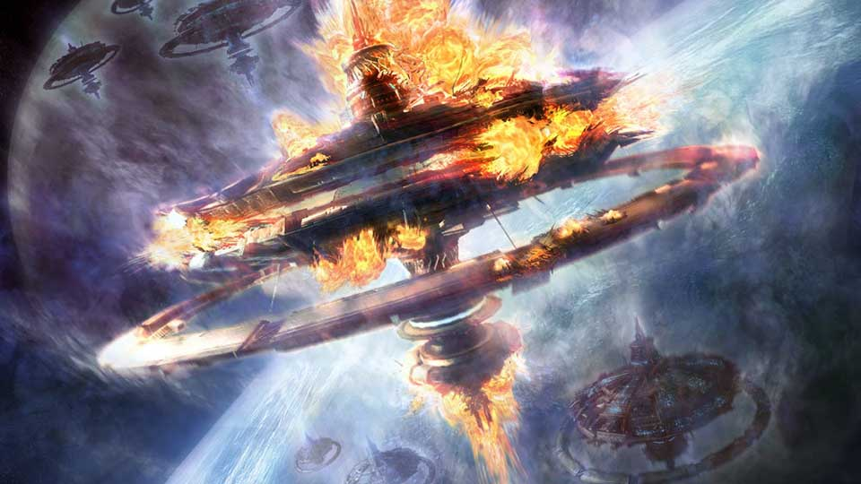

# Aetheria: Terminus

> **Status: active product.** Terminus is the current game. Its first release, **Terminus (Demo)**, is planned for December 2026. The demo is a limited first release, not the complete three-region game.

<figure class="aetheria-media-card">
  
  
Historical concept art. It is not a canonical depiction or evidence of current production.

</figure>

Terminus is Aetheria's cockpit-scale action RPG. The player flies through hostile space in a material ship, makes tactical choices under heat and damage pressure, and fights through a region toward its exit. The game can grow into a longer crossing without requiring the first release to contain the whole galaxy or every faction system.

## Terminus (Demo)

The December 2026 demo is planned as one run through one fixed region. It has 64 zones with a thinned route network, four factions, one gate and one boss. The gate is at the hostile faction's home zone, which is also the exit.

The demo cast is:

- **The Pirates:** the player's ally and ostensible employer.
- **Zhestokost:** the opposing faction; its home zone holds the boss and gate.
- **Lucent Media:** neutral, bringing spectacle to the region.
- **Aeronautics Unlimited:** neutral, providing a familiar baseline among the other factions.

The current scenario source starts the player at the entrance in a Longinus hull; the release brief names a Pirate-made starter hull, so the starting ship's maker needs resolution (see [[Implementation Signals]]). During the run, players travel between zones, decide when to engage, and manage the ship's weapons, heat, visibility, damage, and remaining equipment. The boss blocks the exit. Destroying it opens the route to the gate; reaching the exit wins the run. Ship destruction ends it in defeat.

Stations make the run about more than combat. The release target includes buying equipment, selling recovered goods, repairing damage, and carrying credits through save and Continue. Loot can become money for repairs or a better fit, while damage and heat make each additional fight a decision about how much ship remains for the crossing.

The demo also aims to make combat readable and visceral: distinctive sounds for weapons and world-changing actions; visible impacts on shields and hull; clear damage, heat, and exposure warnings; and faction behavior that players can learn by watching. These are release goals, not a claim that every item is already complete.

The current design draws on [[Action RPG Layer]], [[Galaxy and Navigation]], [[Gravity and Locomotion]], [[Heat, Stealth, and Detection]], [[Faction Play]], and [[Economy and Production]]. Those notes describe the broader systems behind the run. The release boundary and detailed demo conditions are maintained against the Aetheria repository's `docs/aetheria-release-target.md` and `DemoTerminus` scenario.

Nibu's character arc and ship-mind systems are developed separately in [[Lore/Nibu]]. The current demo release plan excludes authored narrative, so her story and related mechanics belong to the wider Terminus design rather than this first release.

## Beyond the Demo

The full Terminus game extends the crossing across three procedurally generated regions. Each region needs enough faction variety to create distinct challenges and stories, with political and economic conditions shaping the run. That larger structure is the product being built toward; the demo proves a smaller, fixed slice of it.

Terminus does not need the full [[Persistent Universe and Reset Loop]] to work. The persistent world remains the long-horizon ambition beyond this single-player release path. Mission and story systems are also broader work: authored narrative is outside the current demo scope.
